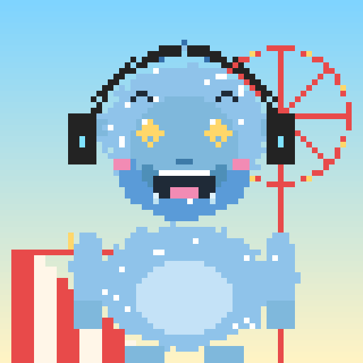
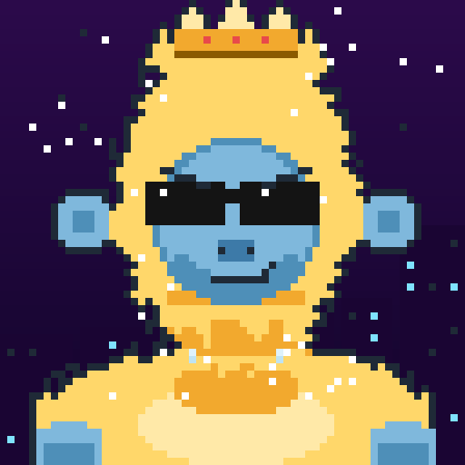

# Lofi PFP Generator ❄️

**Build your own pixel art Lofi Yeti avatar. Free forever, no wallet, no sign-up.**

An entry for the [CLAY Hackathon III](https://hackathon.lofitheyeti.com) by the Lofi Foundation (Sui Network).


## What it does

Pick a fur color, an expression, eyes, an accessory and a background — the Yeti is drawn live, pixel by pixel, on a canvas. Hit **RANDOMIZE** for a surprise Yeti, then **DOWNLOAD PNG** to save a square, PFP-ready 512×512 avatar.

Every Yeti shows its trait list with a rarity label, just like a real NFT collection:

| Trait | Options | Rarities |
|---|---|---|
| Fur | White, Blue, Mint, Pink, Purple, Gold | Common → Legendary |
| Expression | Happy, Sleepy, Cool, Excited | Common / Rare |
| Eyes | Normal, Closed, Sunglasses, Star Eyes | Common → Epic |
| Accessory | None, Scarf, Beanie, Headphones, Crown | Common → Epic |
| Background | Arctic Snow, Gradient Sky, Starry Night, Carnival, Neon City | Common / Rare |

## Examples

| Classic | Blue + Headphones | Gold + Crown |
|---|---|---|
|  |  |  |

## How it works

The Yeti is a **hand-designed pixel sprite** on a 64×64 grid, traced from the reference pixel art of Lofi the Yeti: a round fluffy head, a big blue face, a white beard, wide fur shoulders and blue hands. Fur color is a palette swap on the same sprite; eyes, expressions and accessories are pixel overlays in the same style. No images are fetched or generated: every combination is computed live in your browser, so the same traits always produce the same Yeti.

- **Zero dependencies, zero network requests.** Just static HTML, CSS and JavaScript.
- **Works offline.** Open `index.html` in any modern browser, or serve the folder with any static server:
  ```bash
  python3 -m http.server
  # then open http://localhost:8000
  ```
- **Private by design.** Nothing you make ever leaves your device.

## Project structure

```
index.html   — page layout, controls, trait list
style.css    — pixel-art UI styling (no external fonts or assets)
app.js       — the pixel Yeti renderer + UI logic
logo.svg     — project logo as SVG (same classic Yeti render)
logo.png     — 512×512 PNG version of the logo (for the hackathon form)
yeti-blue.svg / yeti-gold.svg — example renders
```

## Why a PFP generator?

Lofi the Yeti is a community mascot, and every community runs on profile pictures. This tool lets anyone make their own unique pixel Yeti in seconds — no design skills, no minting, no fees. If the Lofi team ever wants to turn the Yetis into a real collection, the trait and rarity system is already there.

## License

MIT — do whatever you want with it, just keep the Lofi love.
